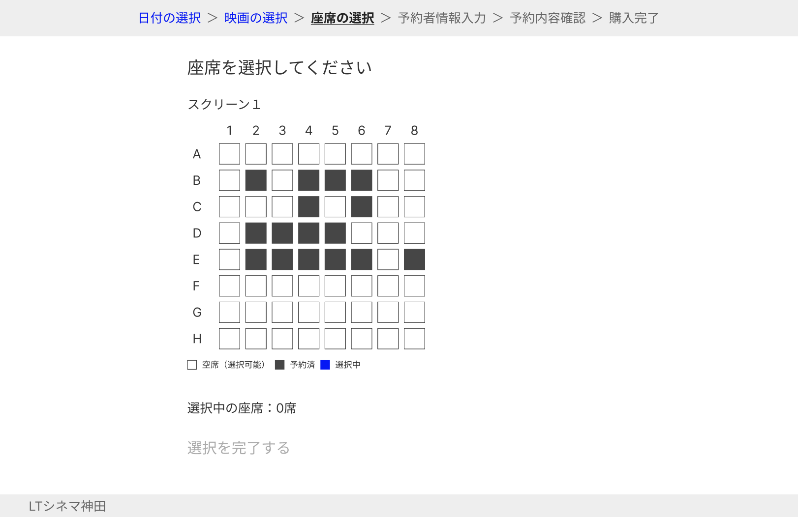

# インターンシップ課題: 映画座席予約システムの開発

## 1. はじめに

この課題は、これまでのインターンシップ研修で学んだ知識の集大成として、実践的なWebアプリケーション開発に挑戦するものです。映画館の座席予約サービスというテーマを通じて、単一の技術要素だけでなく、要件定義から設計、実装、テスト、そしてドキュメント作成に至るまで、開発プロセスの全体像を体験していただきます。

今回の課題は、あなたの総合的なスキルを試す挑戦的な内容です。課題の完了を目標としながらも、開発プロセスにおける課題解決能力や、自律的な学習姿勢を特に重視して評価します。

**ワイヤーフレーム:**

- URL: https://www.figma.com/design/gFi96zC8LnxrdOPkRD9e4C/%E8%AA%B2%E9%A1%8C%E7%94%A8
- パスワード: ltcinema2024



## 2. 達成目標

- **総合的な開発能力の習得**: 要件定義から設計、実装、テスト、デプロイ（仮想）まで、開発の一連の流れを実践する。

- **問題解決能力の向上**: 複雑なロジック（座席の排他制御など）を自力で分析し、解決策を設計・実装する。

- **自律的な学習**: 開発中に直面する未知の技術や課題に対し、公式ドキュメントや信頼できる情報を活用して自律的に解決する。

- **品質への意識**: 可読性の高いコード、適切な設計、そしてテストコードを作成することで、コード品質への意識を高める。

- **ドキュメンテーションの重要性の理解**: 開発内容を第三者に分かりやすく伝えるためのドキュメント（README、設計書など）を作成する。

## 3. 評価のポイント

課題の達成度だけでなく、開発プロセス全体を総合的に評価します。

### 3.1. 技術的評価

- **遂行力**: 期限までに、どこまで成果物を完成させられたか
- **品質**: 成果物の品質（コード、設計、ドキュメント）はどうか
- **問題解決プロセス**: 課題解決の勘所を押さえ、論理的にアプローチできていたか

### 3.2. 学習・成長の評価

- **学習能力**: 初めて触れる技術や知識を素早くキャッチアップし、運用できたか
- **汎化能力**: 経験から学びを抽出し、他の状況に応用するサイクルを回せていたか
    - [具体的経験] → [内省] → [一般化/教訓化] → [新たな状況に適用] のサイクル
- **コミットメント**: 課題を完成させるために、最後まで粘り強くコミットできたか

### 3.3. 理解度の評価

- **理解度**: 提出物に関する内容（設計の意図、実装したロジックなど）を明確に説明できるか
- 提出後にインタビューを実施し、実装内容について質問します

## 4. 動作環境と事前準備

開発を始める前に、お使いのPCに以下の環境が整っていることを確認してください。

- **PHP**: 8.3以上
- **Composer**: 2.0以上
- **Node.js**: `.nvmrc` に指定されたバージョン
- **npm**: Node.js に付属するバージョン
- **MySQL**: 8.0以上
- **Git**: 2.0以上
- **ghq**: 最新版

## 5. 環境構築と初回起動

提供されたリポジトリをクローンし、以下の手順でローカル開発環境をセットアップしてください。

### 5.1. リポジトリのクローンと移動

```bash
# ghq をまだインストールしていない場合
brew install ghq

# メンターから指定されたリポジトリURLを設定してクローン
REPOSITORY_URL="https://github.com/your-organization/movie-reservation-system.git"
ghq get "$REPOSITORY_URL"

# プロジェクトディレクトリへ移動
cd "$(ghq list -p -e movie-reservation-system)"

# 開発用ブランチを作成
git switch -c develop

# 開発用ブランチをプッシュ
git push origin develop

# VSCodeで開く
code .
```

### 5.2. 依存関係のインストール

```bash
# PHPパッケージのインストール
composer install

# Node.js をインストール
nvm install

# Node.js のバージョンを指定
nvm use

# Node.jsパッケージのインストール
npm install

# ビルド
npm run build
```

### 5.3. 環境変数の設定

```bash
# .env.exampleを.envにコピー
cp .env.example .env

# アプリケーションキーの生成
php artisan key:generate --ansi
```

### 5.4. データベースのセットアップ

```bash
# MySQL をまだインストールしていない場合
brew install mysql

# MySQLの起動
brew services start mysql

# データベースとテーブルを作成（データベースを作成するか否かを聞かれたら「Yes」を入力）
php artisan migrate

# データベースの確認
mysql -u root -e "show databases;"

# テーブルの確認
mysql -u root movie_reservation -e "show tables;"

# 初期シードデータの投入
php artisan db:seed
```

### 5.5. アプリケーションの起動

```bash
# CIの実行
composer run ci

# MySQLの起動
brew services restart mysql

# 開発サーバーの起動
composer run dev
```

ブラウザで `http://localhost:8000` にアクセスし、Welcomeページが表示されることを確認してください。

### 5.6. VS Code 拡張機能のインストール (推奨)

VS Code を利用している場合、プロジェクトの `.vscode/extensions.json` ファイルに、開発に推奨される拡張機能が定義されています。これらの拡張機能をインストールすることで、コード補完、定義への移動、フォーマット、静的解析などの機能が強化され、開発効率が向上します。デバッグが必要な場合は、別途 Xdebug と PHP Debug 拡張を設定してください。

1.  VS Code を起動し、このプロジェクトのフォルダを開きます。
2.  VS Code の右下に **「このワークスペースに推奨される拡張機能があります。」** という通知が表示されます。
3.  **「すべてインストール」** ボタンをクリックすると、推奨される拡張機能がまとめてインストールされます。

もし通知が表示されない場合は、VS Code の左側にある拡張機能ビュー（Ctrl+Shift+X または Cmd+Shift+X）を開き、「@recommended」と検索すると、推奨される拡張機能が表示されます。

## 6. 機能要件

### 6.1. サービスの基本的な流れ（バックボーン）

1. ユーザーがサイトにアクセスする
2. 映画館を選択する
3. 日付を選択する
4. 映画を選択する
5. 上映回を選択する
6. 座席を選択する
7. 申込者情報を入力する
8. クレジットカード情報を入力する
9. 確認画面で入力内容を確認する
10. 不備があれば編集画面に戻る
11. 入力内容を確定する
12. 予約完了画面が表示される
13. 予約完了画面を印刷する（PDFまたは印刷用画面）

### 6.2. 必須実装機能（Must Have）

#### データ整合性の確保

- **座席の排他制御**: 同じ座席が同時に複数のユーザーに予約されないよう、適切な排他制御を実装する
- **トランザクション制御**: 予約処理において、適切なトランザクション管理を行う
- **座席ロック機能**: 座席選択中は他のユーザーが選択できないようロックする（仮押さえの有効期限は15分間）
- **ロック自動解除**: 座席を仮押さえしたまま離脱した場合、座席のロックを自動解除する（仮押さえの有効期限は15分間）

#### バリデーション

- **フォーム入力検証**: 各入力フォームで適切なバリデーションをサーバーサイドで実装
- **エラーメッセージ**: ユーザーフレンドリーなエラーメッセージの表示

#### セキュリティ対策

- **迷惑ユーザー対策**: 大量の座席を仮押さえして放置するユーザーへの対策
- **CSRF対策**: LaravelのCSRF保護機能を適切に使用
- **SQLインジェクション対策**: Eloquent ORMまたはプリペアドステートメントの使用
- **XSS対策**: Bladeテンプレートの適切な使用

#### UX

- その他、ユーザー体験の向上に関する工夫を自分で考えて実装する
- ユーザーが誤って操作した場合のリカバリーフローをどうするかを考えて実装する

#### 開発環境

- **シードデータ**: 開発・テスト用の初期データを自動生成できるようにする
- **動的データ生成**: 上映スケジュールはSeeder実行時の日付に基づいて動的に生成できるようにする
- **コード品質**: `composer run ci` でフォーマットエラー/静的解析エラー/テストの失敗がないことを確認する

### 6.3. スコープ外（Out of Scope）

- **ユーザー認証**: ログイン機能、アカウント作成機能は不要
- **管理者機能**: 映画や上映スケジュールの管理画面は不要（シードデータで対応）
- **モバイル対応**: PCレイアウトのみの実装でOK（レスポンシブ対応は任意）
- **決済処理**: 実際の決済は行わず、モック関数で対応
    - 残高チェックなどの代わりに常に true を返すメソッドで代替
- **メール送信**: 予約確認メールは送信せず、画面表示で代替
    - 申込完了画面で「このページを印刷してください」と表示すればOK
- **予約履歴**: 過去の予約履歴閲覧機能は不要

## 7. 提出物（成果物）

### 7.1. 設計ドキュメント

以下の設計書を README.md にまとめて提出してください。

- [ ] ユースケース一覧（ユースケース詳細は不要）
- [ ] 画面一覧表（画面の詳細設計書は不要）
- [ ] DBテーブル設計書（CREATE TABLE文をインデックス、文字コード、照合順序も含めて設計して作成して記述）
- [ ] DBクエリ設計書（使用する全SQLを記述）
- [ ] API仕様書（OpenAPI仕様）

### 7.2. アプリケーション

- [ ] ソースコード一式（GitHubリポジトリ）
- [ ] ローカル環境で動作するプロトタイプ

### 7.3. テスト

- [ ] 開発環境用シードデータ（Laravel の Seeder を用いて定義する）
- [ ] Pest Unitテスト（任意課題）
- [ ] Pest Featureテスト（任意課題）
- [ ] Laravel Duskブラウザテスト（任意課題）
- [ ] テスト実行手順書（任意課題）

### 7.4. その他

- [ ] README.md（設計ドキュメント、環境セットアップ手順をまとめる）
- [ ] 動作確認動画
- [ ] プルリクエスト（develop → main）

## 8. 期限

- **推奨期間**: 2ヶ月
- **最大期間**: 3ヶ月

期限内であれば、早期提出も歓迎します。完成度に加えて、開発プロセスと学習姿勢も重視します。

## 9. 課題を進めるにあたっての注意点

- 開発コードは小まめにコミット、プッシュを行うこと
    - 少なくとも、1日に1回はコミット、プッシュを行うこと
- 適切にログを仕込むことでデバッグをしながら開発を進めること
    - `dd()` ([参考](https://laravel.com/docs/13.x/helpers#method-dd))
    - `dump()` ([参考](https://laravel.com/docs/13.x/helpers#method-dump))
    - `logger()` ([参考](https://laravel.com/docs/13.x/logging#writing-log-messages))
    - `Log::debug()` ([参考](https://laravel.com/docs/13.x/logging#writing-log-messages))
    - `storage/logs/laravel.log`
- 必要に応じてこれまでに学習で使用してきた参考書籍を読み返しながら開発を進めること
- コードレビュー観点
    - [ ] N+1問題の回避
    - [ ] 適切なインデックス使用
    - [ ] トランザクション範囲の妥当性
    - [ ] エラーハンドリング
    - [ ] 適切な命名

## 10. 参考資料

### 10.1. ワイヤーフレーム

- URL: https://www.figma.com/design/gFi96zC8LnxrdOPkRD9e4C/%E8%AA%B2%E9%A1%8C%E7%94%A8
- パスワード: ltcinema2024
- 最終確認日: 2024年11月

### 10.2. Laravel開発のベストプラクティス

- [Laravel Best Practices（日本語）](https://github.com/alexeymezenin/laravel-best-practices/blob/master/japanese.md)
- [Laravel公式ドキュメント](https://laravel.com/docs/13.x)
- [Laravel 13 アップグレードガイド](https://laravel.com/docs/13.x/upgrade)
- [Eloquent ORM](https://laravel.com/docs/13.x/eloquent)
- [データベースマイグレーション](https://laravel.com/docs/13.x/migrations)

### 10.3. パフォーマンス最適化

- [MySQL EXPLAIN入門](https://speakerdeck.com/infiniteloop_inc/mysql-index-plus-explainru-men)
- [MySQL EXPLAIN解説](https://speakerdeck.com/infiniteloop_inc/mysql-explain-jie-shuo)

## 11 生成AIの利用について

本研修においては、生成AIの出力を参考にすることは**許可します**。ただし、その内容を鵜呑みにせず、最終的には自身の判断と責任で実装してください。特に以下の点に注意してください：

- セキュリティに関わる実装は、必ず公式ドキュメントで確認する
- パフォーマンスに関わる部分は、実際に測定して検証する
- ビジネスロジックは、要件を正確に理解した上で実装する
- 提出物に関する内容（設計の意図、実装したロジックなど）を明確に説明できるようにする

## 12. 開発の進め方（マイルストーン）

この課題を円滑に進めるためのマイルストーンを設定しました。この通りに進めることを推奨しますが、状況に応じて柔軟に進めて構いません。

### Step 0. 生成AIとの壁打ち

生成AIに次の質問を順次投げて、その都度、どのような回答が得られるかを確認してください。（会社の Google アカウントで Gemini が使えます。） 
システム開発全体の雰囲気を掴んでください。

**注意**: ここで得られる回答が「正」ではありません。あくまでも、システム開発の雰囲気を掴むためのヒントとして活用してください。

1. 映画の予約アプリを作りたい。世の中のニーズやペインの分析をして。
2. 事業性を検討して。
3. ビジネスモデルを検討して。
4. 事業計画書を作って。
5. サービス名をブレストして。最終的に一つに絞り込んで提案して。
6. コピーライティングして。
7. エレベーターピッチを作って。
8. インセプションデッキを作って。
9. プロジェクト憲章を作って。
10. 開発工数の概算見積もりを出して。<制約条件>・Webアプリケーション・Laravel・MySQL・HTMLを返却するMPA・必要に応じて部分的に非同期APIを実装</制約条件>
11. 開発費用の概算見積もりを出して。
12. 機能要件定義、非機能要件定義、抽象データ要件定義をして。<制約条件>・Webアプリケーション・Laravel・MySQL・HTMLを返却するMPA・必要に応じて部分的に非同期APIを実装・映画館は複数存在すること・それぞれの映画館は複数のスクリーンを持っていること</制約条件>
13. アクターを整理してユースケース一覧を作って。
14. 実装にあたり慎重な設計や工夫が必要なロジックやアルゴリズムを整理して。
15. 全てのユースケースに対して、ユースケース詳細を漏れなく作成して。
16. テスト設計書を作成して。
17. ユーザーストーリー形式で整理して。
18. ユーザーストーリーマッピングを作成して。
19. 構造化シナリオ法を用いて、ユーザーの本質的要求価値から具体的なUIまでを段階的にブレイクダウンしながらシナリオを作成して。まず、ユーザーのペルソナとビジネスゴールを設定し、それを元にしたシナリオの抽象度を段階的に具体化していって（提供する体験価値→行動・心理→UI）。
20. 概念データ設計をして（データベース設計は除く）。
21. データフローを高レベルで設計して。
22. データベース設計をして。
23. ユースケース一覧/ユースケース詳細/データフロー設計/データベース設計に基づき、全てのユースケースに対して、アプリケーションで実装されるクエリ（SQL）を全て作成して。トランザクション/排他制御/ページネーションも考慮して。クエリの作成中にインデックスの不足に気づいた場合は指摘して。
24. 画面一覧表を作成して。
25. 漏れなく全画面を対象に、各画面の詳細設計をして。
26. エンドポイントの一覧を作って。<制約条件>・Webアプリケーション・Laravel・MySQL・HTMLを返却するMPA・必要に応じて部分的に非同期APIを実装</制約条件>
27. OpenAPI仕様に基づいてエンドポイントの設計をして。<注意>・大部分がtext/htmlを返却するエンドポイントであることに留意・考えられるエラーレスポンス（仮押さえの有効期限切れなど）も網羅すること</注意>
28. 開発工数の詳細見積もりを出して。
29. 開発費用の詳細見積もりを出して。
30. リリースノート駆動開発に向けてリリースノートを作成して。
31. 上記のアプリを採用応募者(開発者)の力量/理解度を測るテスト課題として与えようと思います。ただし、全部を作るとなると工数が嵩みすぎるのでスコープを限定したいです。期間は8~12週間程度とします。応募者の力量を測る目的で、効果的に力量を測るには、どのスコープに限定するのがいいですか。理由も合わせて回答してください。

### Step 1. 要件定義・設計フェーズ

AIとの壁打ちを参考にして、要件定義・設計フェーズを進める。

- ユースケース一覧の作成
    - アクターを整理する
    - ユースケース一覧を作成する（ユースケース詳細は不要）
- 画面一覧表の作成
    - 画面の詳細設計書は不要
- クリティカルな仕様の検討
    - 座席のダブルブッキング防止策
    - 悪意あるユーザーへの対策
    - etc.

### Step 2. データベース設計（骨格のみ）

- エンティティの洗い出しとリレーション定義
- ER図の作成（任意）
- テーブル定義（CREATE TABLE文）の作成
    - この段階では主キーと外部キーだけのテーブルを設計する
    - 詳細なプロパティは後で追加する
- インデックス設計

### Step 3. クエリ設計

ユーザーアクティビティ（バックボーン）に沿って、ユースケースごとに SQL を全て書き出す。

- 留意事項
    - トランザクション/排他制御/ページネーションも考慮すること
    - `where` 句や `order by` 句で必要なカラムが出てきた場合は CREATE 文の設計に戻りカラムを追加すること
    - SQL で変数となる箇所はクライアントからサーバーへのパラメータの受け渡し方法を頭で考えておくこと
    - SQL だけで完結せず PHP での処理が必要になる箇所は、簡潔にコメントを添えること

以下、作業例。

#### 映画館の一覧を表示する

```sql
-- (このときの SQL はどうなる？)
```

#### 日付の一覧を表示する

※ 日付の一覧は SQL ではなく PHP で生成する

#### 映画の一覧を取得する

```sql
-- (このときの SQL はどうなる？)
```

#### 上映回の一覧を表示する

```sql
-- (このときの SQL はどうなる？)
```

※ PHPで制御して、上映時刻を過ぎた回は、画面表示はしつつ、グレーアウトで選択できないようにする。

#### 座席の一覧を表示する

```sql
-- (このときの SQL はどうなる？)
```

#### 自分が仮押さえ済みの座席は画面上で強調表示する

```sql
-- (このときの SQL はどうなる？)（PHP で追加の処理は必要？）
```

#### 選択した座席を仮押さえする

`トランザクションを開始する`

```sql
begin;

-- （ここでなんらかのSQL）
```

`PHPでなんらかの処理をする`

```php
// （どんな処理をするかを自然言語で説明）
```

`トランザクションを終了する`

```sql
-- （ここでなんらかのSQL）

commit;
```

### Step 4. レビュー (#1)

要件定義・設計・データベース設計について、メンターにレビューを依頼。

### Step 5. データベース設計（完成）

- CREATE文を完成させる
    - SELECT 句で必要になるカラムを追加する
    - Index を追加する

### Step 6. レビュー (#2)

データベース設計について、メンターにレビューを依頼。

### Step 7. SQLのパフォーマンス検証

#### 7.1. 大量のデモデータをDBに投入する

- 設計したエンティティを Eloquent モデルとして実装する
    - ファイルの作成（モデル、マイグレーション、ファクトリ）（[参考](https://laravel.com/docs/13.x/eloquent)）
        - `php artisan make:model モデル名 -mf`
        - `php artisan make:model 中間モデル名 -mf -p`
    - マイグレーションファイルにテーブル定義を記述（[参考](https://laravel.com/docs/13.x/migrations)）
    - モデルファイルにエンティティ同士のリレーションを記述（[参考](https://laravel.com/docs/13.x/eloquent-relationships)）
- ファクトリファイルに faker でデフォルト値を定義する（[参考](https://laravel.com/docs/13.x/eloquent-factories)）
- `databse/seeders/DatabaseSeeder.php` にファクトリを使用したデータ作成を処理を記述する（[参考](https://laravel.com/docs/13.x/eloquent-factories)）
- マイグレーションを実行してデータを投入する（`php artisan migrate:fresh --seed`）（[参考](https://laravel.com/docs/13.x/migrations)）

#### 7.2. パフォーマンス検証（SQL）

SQL を使用したデータフェッチのパフォーマンスを確認する。

- クエリ設計で作成した SQL を Sequel Ace で実行してパフォーマンスを確認する
    - 一般的に、Webアプリケーションではページの読み込み速度は2秒以内が推奨とされている
    - 2秒の内訳:
        - サーバーがリクエストを受け取り、レスポンスを返す・・・0.2秒
        - ブラウザがレスポンスを受け取り、レンダリングする・・・1.8秒
    - 一度のリクエストで複数のSQLを実行するなら、すべての実行時間を合わせても200ms以内に収まるのが理想
        - 優秀: < 50ms
        - 良好: 50-200ms
        - 要改善: 200-500ms
        - 不可: > 500ms
    - 実行に時間が掛かるSQLがある場合は、テーブル/クエリ設計に改善の余地があると考えてよい
- SQLの実行計画を確認して、インデックスの不足を把握する （`explain select ~~`）
    - [参考1](https://speakerdeck.com/infiniteloop_inc/mysql-index-plus-explainru-men)
    - [参考2](https://speakerdeck.com/infiniteloop_inc/mysql-explain-jie-shuo)
    - 上記の解説が難しければ、その他の解説を自分で探してキャッチアップする

#### 7.3. パフォーマンス検証（Eloquent）

Eloquent モデルを使用したデータフェッチのパフォーマンスを確認する。

- Artisanコマンドを作成する（`php artisan make:command Play`）（[参考](https://laravel.com/docs/13.x/artisan)）
- コマンドファイルを編集する（`app/Console/Commands/Play.php`）
    - Eloquent モデルを使ってデータ取得処理を書く（[参考](https://laravel.com/docs/13.x/eloquent)）
    - SQLと実行時間をデバッグする（実際のユースケースに合わせて、データ取得のロジックを書く）
        ```php
        DB::enableQueryLog();
        $data = User::query()->where('id', 1)->get();
        dump(DB::getQueryLog());
        ```
- コマンドを実行する（`php artisan app:play`）

### Step 8. エンドポイント設計

生成AIとの壁打ちを参考にして、エンドポイントの設計書（API仕様書）を作成する。

- エンドポイントの一覧を作成する
- 各エンドポイントの詳細設計を作成する

### Step 9. レビュー (#3)

SQL のパフォーマンス検証について、メンターにレビューを依頼。

### Step 10. アプリケーションの骨格を作成する

- Laravel でアプリケーションのバックボーンを実装する
- UI は HTML だけで作る仮実装とする（CSS や JavaScript は使わない）
    - 例
        - 一覧は ul > li > a で簡易的に実装する
        - 座席選択は label > checkbox で簡易的に実装する
- トランザクション制御はこの段階で実装すること

### Step 11. レビュー (#4)

エンドポイント設計、アプリケーションの骨格について、メンターにレビューを依頼。

### Step 12. アプリケーションの肉付けを行う

- CSS や JavaScript を用いてフロントエンドの仮実装を本実装に置き換える
- バリデーションチェックやエラーメッセージの表示など、細かい制御を実装する
- その他、予期しない操作をユーザーが行った場合の制御を実装する（UXの観点から妥当な制御をすること）

### Step 13. テストを実施する

- 手動でテストを実施する

### Step 14. README.md の最終調整を行う

- README.md に過不足がないか最終確認を行う
    - アプリケーションのセットアップ手順、起動手順は記載されているか
    - 設計ドキュメントが記載されているか

### Step 15. 動作確認用の動画を作成する

- 画面収録を行い、アプリケーションの動作を確認できるデモ動画を作成する

### Step 16. テストコードを作成する（任意課題）

- テストコードを作成する
    - PHP Unit による単体・機能テスト
    - Dusk によるブラウザテスト
- 自動テストの実行手順を README.md に記載する

### Step 17. 課題提出

- `develop` ブランチから `main` ブランチに向けてプルリクエストを作成する
    - 開発中は小まめにコミット、プッシュしながら開発を進めること
    - 提出期限になったら、進められている範囲までで提出すること
- デモ動画を Slack にアップロードする

### Step 18. レビュー（理解度テスト）

提出された成果物についての理解度を測るインタビューを実施します。

### Step 19. 課題の振り返りとブラッシュアップ

- `develop` から `post-submit` ブランチを作成する
- `post-submit` ブランチで追加の作業を行う
    - 提出期限に間に合わなかった部分の実装
    - フィードバック（レビュー、インタビュー）の反映
    - さらなる機能拡張
