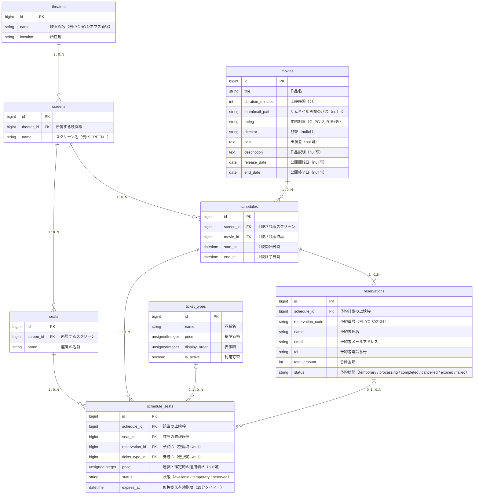

# インターンシップ最終選考課題: 映画座席予約システムの開発 ([課題詳細](./CHALLENGE.md))

劇場の上映スケジュール閲覧から、リアルタイムな座席確保、予約者情報入力、予約完了までを行うWebアプリケーションです。


---

## 動作環境 (Requirements)

- **PHP**: 8.4.23
- **Composer**: 2.10.1
- **Node.js**: v26.3.0
- **Database**: MySQL 8.0 以上
- **Laravel Framework**: 10.x / 11.x

---

## セットアップ手順 (Setup Guide)

開発環境をローカルに構築し、アプリケーションを実行可能な状態にするための手順です。

```bash
#  ① リポジトリのクローン
git clone [https://github.com/your-repo/intern-movie-reservation-system-shiratori.git](https://github.com/your-repo/intern-movie-reservation-system-shiratori.git)
cd intern-movie-reservation-system-shiratori

# ② 依存パッケージのインストール
composer install
npm install

# ③ 環境設定ファイル（.env）の作成
cp .env.example .env

# ④ アプリケーションキーの生成
php artisan key:generate

# ⑤ データベースの作成と初期データの投入
php artisan migrate:fresh --seed

# ① 開発サーバーおよびアセットビルドの起動
php artisan serve
npm run dev
```

---

## ユースケース一覧

| UC ID | ユースケース名               | 主なアクター | 概要                                                                                  |
| :---: | :--------------------------- | :----------: | :------------------------------------------------------------------------------------ |
| UC-01 | トップページを閲覧する       | 一般ユーザー | 最新映画、直近7日間の予約座席数による人気映画ランキング、劇場検索への導線を閲覧する。 |
| UC-02 | 劇場・上映スケジュールを探す | 一般ユーザー | 劇場名・住所で劇場を検索し、指定日付の上映作品・上映枠・空席状況を確認する。          |
| UC-03 | 映画詳細を閲覧する           | 一般ユーザー | 映画一覧または上映スケジュールから、映画の詳細情報を閲覧する。                        |
| UC-04 | 座席を仮予約する             | 一般ユーザー | 上映枠の座席を最大6席まで選択し、排他制御下で15分間仮確保する。                       |
| UC-05 | 券種を選択する               | 一般ユーザー | 仮確保した各座席に有効な券種を設定し、合計金額を保存する。                            |
| UC-06 | 予約者情報を入力する         | 一般ユーザー | 氏名・電話番号・メールアドレスを入力し、予約確認画面へ進む。                          |
| UC-07 | 予約を確定する               | 一般ユーザー | 予約内容を確認して決済を実行し、仮予約を確定済み予約へ更新する。                      |
| UC-08 | 進行中の仮予約を処理する     | 一般ユーザー | 別上映枠の仮予約がある場合に、既存手続きを再開するか破棄して新規予約へ進む。          |

---

## 画面一覧表

| 画面ID | 画面名               | View                              | 主要機能・処理内容                                                     |
| :----: | :------------------- | :-------------------------------- | :--------------------------------------------------------------------- |
| SCR-01 | トップページ         | `home/index.blade.php`            | 最新映画スライダー、人気映画ランキング、劇場検索・一覧への導線を表示。 |
| SCR-02 | 劇場一覧画面         | `theaters/index.blade.php`        | 劇場名・住所検索、ページネーション、劇場一覧を表示。                   |
| SCR-03 | 上映スケジュール画面 | `theaters/schedules.blade.php`    | 劇場・日付ごとの上映作品、上映枠、空席状況を表示。                     |
| SCR-04 | 映画一覧画面         | `movies/index.blade.php`          | 映画作品の一覧を表示。                                                 |
| SCR-05 | 映画詳細画面         | `movies/show.blade.php`           | 映画の詳細情報を表示。                                                 |
| SCR-06 | 座席選択画面         | `reservations/seats.blade.php`    | 座席図を表示し、最大6席を選択して仮予約を作成。                        |
| SCR-07 | 券種選択画面         | `reservations/tickets.blade.php`  | 仮予約座席ごとに券種を設定し、合計金額を表示。                         |
| SCR-08 | 予約者情報入力画面   | `reservations/customer.blade.php` | 氏名・電話番号・メールアドレスを入力。                                 |
| SCR-09 | 予約内容確認画面     | `reservations/confirm.blade.php`  | 座席・券種・金額・予約者情報を確認し、予約確定へ進む。                 |
| SCR-10 | 仮予約通知画面       | `reservations/holding.blade.php`  | 進行中の仮予約を再開するか、破棄して新規予約を開始するか選択。         |
| SCR-11 | 購入完了画面         | `reservations/thanks.blade.php`   | 予約確定後の予約内容と完了メッセージを表示。                           |
| SCR-12 | エラー画面           | `errors/{status}.blade.php`       | 404、405、419、429、500、503 のエラー内容と遷移先を表示。              |

---

## ビューディレクトリ構造

```
resources/views/
├── auth/                              # Laravel Breeze の認証画面
│   ├── confirm-password.blade.php
│   ├── forgot-password.blade.php
│   ├── login.blade.php
│   ├── register.blade.php
│   ├── reset-password.blade.php
│   └── verify-email.blade.php
├── components/                        # 共通UIコンポーネント
│   ├── application-logo.blade.php
│   ├── auth-session-status.blade.php
│   ├── danger-button.blade.php
│   ├── dropdown-link.blade.php
│   ├── dropdown.blade.php
│   ├── input-error.blade.php
│   ├── input-label.blade.php
│   ├── modal.blade.php
│   ├── movie-detail.blade.php
│   ├── navigation.blade.php
│   ├── nav-link.blade.php
│   ├── primary-button.blade.php
│   ├── responsive-nav-link.blade.php
│   ├── secondary-button.blade.php
│   └── text-input.blade.php
├── errors/                            # HTTPエラー画面
│   ├── 404.blade.php
│   ├── 405.blade.php
│   ├── 419.blade.php
│   ├── 429.blade.php
│   ├── 500.blade.php
│   └── 503.blade.php
├── home/
│   └── index.blade.php
├── layouts/
│   └── app.blade.php                  # 共通レイアウト
├── movies/
│   ├── index.blade.php
│   └── show.blade.php
├── profile/
│   ├── edit.blade.php
│   └── partials/
│       ├── delete-user-form.blade.php
│       ├── update-password-form.blade.php
│       └── update-profile-information-form.blade.php
├── reservations/
│   ├── partials/
│   │   └── purchase-detail.blade.php
│   ├── confirm.blade.php
│   ├── customer.blade.php
│   ├── holding.blade.php
│   ├── seats.blade.php
│   ├── thanks.blade.php
│   └── tickets.blade.php
└── theaters/
    ├── index.blade.php
    └── schedules.blade.php
```

---

## 設計手順（マイルストーン）

|        フェーズ        |                                                    作業内容                                                     |                   主な成果物・ゴール                   |
| :--------------------: | :-------------------------------------------------------------------------------------------------------------: | :----------------------------------------------------: |
|    生成AIとの壁打ち    |                                    映画予約アプリに関する開発概要を把握する                                     |               システム開発の雰囲気を掴む               |
|        要件定義        |                                       壁打ちをもとに要件定義・設定を行う                                        | ユースケース一覧・画面一覧表・クリティカルな仕様の検討 |
|         DB設計         |                          マイグレーションファイル作成にあたって必要な設計図を作成する                           |   DB設計図（ER図、CREATE TABLE文、クエリ設計を含む）   |
|         DB構築         |                   マイグレーションファイル作成・テスト用マスタデータ（劇場・座席・枠）の作成                    |               migrations・DatabaseSeeder               |
|   パフォーマンス検証   |                    クエリ設計で作成したクエリ文によりデータベースのパフォーマンスを検証する                     |              目標時間内に処理時間を納める              |
|   エンドポイント構築   | ルーティング設定（Web / API）・フォームリクエスト（バリデーション）作成・セッションでの状態保持・遷移制御の実装 |        routes/web.php・Controller・FormRequest         |
|   バックボーンの実装   |                           Bladeテンプレート作成（全6画面）・トランザクション制御など                            |             resources/views/（6画面）など              |
| アプリケーションの調整 |               フロントエンドの仮実装を本実装に置き換える、バリデーションチェックなどの細かい制御                |             ミドルウェア / 例外ハンドラー              |
|      READMEの調整      |                      READMEにセットアップ手順や設定ドキュメントの記載などの最終調整を行う                       |                       README.md                        |
|     仕上げ・テスト     |    全画面を通した一連の動作確認・N+1問題のチェック（Laravel Telescope/Debugbar等）・コードのリファクタリング    |              動作確認済みアプリケーション              |

---

## DBテーブル設計書

### DBテーブル一覧

|       テーブル名       | 役割・概要                                               | 関連する機能・画面               |
| :--------------------: | :------------------------------------------------------- | :------------------------------- |
|         users          | ログインユーザーのアカウント情報                         | 認証・プロフィール               |
| password_reset_tokens  | パスワード再設定用トークン                               | パスワード再設定                 |
|        theaters        | 映画館情報（名称・所在地）                               | 劇場・上映一覧                   |
|        screens         | 映画館に属するスクリーン                                 | 劇場・上映一覧、座席選択         |
|         seats          | スクリーンごとの物理座席                                 | 座席選択                         |
|         movies         | 映画作品情報（タイトル、作品情報、公開期間など）         | ホーム、映画詳細                 |
|       schedules        | 上映枠（映画・スクリーン・上映開始／終了時刻）           | 劇場・上映一覧、座席選択         |
|      ticket_types      | 券種と基準価格、有効・表示順                             | チケット選択                     |
|      reservations      | 予約番号、予約者、合計金額、予約状態を保持               | 仮予約、購入者情報、予約完了     |
|     schedule_seats     | 上映枠ごとの座席状態、仮押さえ期限、適用券種・価格を保持 | 座席選択、チケット選択、予約完了 |
|        sessions        | ログインセッション                                       | 認証                             |
|         cache          | アプリケーションのキャッシュ                             | システム内部                     |
|      cache_locks       | キャッシュロック                                         | システム内部                     |
|      failed_jobs       | 失敗したキュージョブ                                     | システム内部                     |
| personal_access_tokens | API 認証トークン                                         | API 認証（利用時）               |
|   telescope_entries    | Telescope のリクエスト・例外等の計測ログ                 | 開発・運用                       |
| telescope_entries_tags | Telescope ログのタグ                                     | 開発・運用                       |
|  telescope_monitoring  | Telescope の監視対象                                     | 開発・運用                       |

### ER図

予約処理の中心となる業務テーブルの関係です。`schedule_seats` は上映枠と物理座席の組み合わせを表し、仮押さえ・予約済み状態、予約・券種・確定価格を保持します。`users` と Laravel の基盤テーブルは予約テーブルと直接関連しないため、ER 図からは省略しています。



主な制約・インデックスは次のとおりです。

- `theaters.name` は一意、`screens` は `theater_id` と `name` の組み合わせで一意、`seats` は `screen_id` と `name` の組み合わせで一意です。
- `schedule_seats` は `schedule_id` と `seat_id` の組み合わせで一意です。同じ上映枠に同一座席を重複して作成できません。
- 上映検索用に `schedules(screen_id, start_at)`、仮押さえの失効処理用に `schedule_seats(schedule_id, status, expires_at)` と `schedule_seats(status, expires_at)` を設定しています。
- ホームの週間予約数ランキング用に `reservations(status, created_at)` と `schedule_seats(schedule_id, status, reservation_id)` を設定しています。

### DB設計（業務テーブル）

以下は現行のマイグレーションに対応する業務テーブルの論理 SQL です。認証・キャッシュ・Telescope などの Laravel 基盤テーブルは、各パッケージのマイグレーション定義を正とします。

```sql
CREATE TABLE ticket_types (
  id BIGINT UNSIGNED AUTO_INCREMENT PRIMARY KEY,
  name VARCHAR(255) NOT NULL,
  price INT UNSIGNED NOT NULL,
  display_order INT UNSIGNED NOT NULL DEFAULT 0,
  is_active TINYINT(1) NOT NULL DEFAULT 1,
  created_at TIMESTAMP NULL,
  updated_at TIMESTAMP NULL
);

CREATE TABLE theaters (
  id BIGINT UNSIGNED AUTO_INCREMENT PRIMARY KEY,
  name VARCHAR(255) NOT NULL,
  location VARCHAR(255) NOT NULL,
  created_at TIMESTAMP NULL,
  updated_at TIMESTAMP NULL,
  UNIQUE KEY theaters_name_unique (name)
);

CREATE TABLE screens (
  id BIGINT UNSIGNED AUTO_INCREMENT PRIMARY KEY,
  theater_id BIGINT UNSIGNED NOT NULL,
  name VARCHAR(10) NOT NULL,
  created_at TIMESTAMP NULL,
  updated_at TIMESTAMP NULL,
  CONSTRAINT screens_theater_id_foreign
    FOREIGN KEY (theater_id) REFERENCES theaters(id) ON DELETE CASCADE,
  UNIQUE KEY uq_theater_screen_name (theater_id, name)
);

CREATE TABLE seats (
  id BIGINT UNSIGNED AUTO_INCREMENT PRIMARY KEY,
  screen_id BIGINT UNSIGNED NOT NULL,
  name VARCHAR(10) NOT NULL,
  created_at TIMESTAMP NULL,
  updated_at TIMESTAMP NULL,
  CONSTRAINT seats_screen_id_foreign
    FOREIGN KEY (screen_id) REFERENCES screens(id) ON DELETE CASCADE,
  UNIQUE KEY uq_screen_seat (screen_id, name)
);

CREATE TABLE movies (
  id BIGINT UNSIGNED AUTO_INCREMENT PRIMARY KEY,
  title VARCHAR(255) NOT NULL,
  duration_minutes SMALLINT UNSIGNED NOT NULL,
  thumbnail_path VARCHAR(255) NULL,
  rating VARCHAR(10) NULL,
  director VARCHAR(255) NULL,
  cast TEXT NULL,
  description TEXT NULL,
  release_date DATE NULL,
  end_date DATE NULL,
  created_at TIMESTAMP NULL,
  updated_at TIMESTAMP NULL,
  UNIQUE KEY movies_title_unique (title)
);

CREATE TABLE schedules (
  id BIGINT UNSIGNED AUTO_INCREMENT PRIMARY KEY,
  screen_id BIGINT UNSIGNED NOT NULL,
  movie_id BIGINT UNSIGNED NOT NULL,
  start_at DATETIME NOT NULL,
  end_at DATETIME NOT NULL,
  created_at TIMESTAMP NULL,
  updated_at TIMESTAMP NULL,
  CONSTRAINT schedules_screen_id_foreign
    FOREIGN KEY (screen_id) REFERENCES screens(id) ON DELETE CASCADE,
  CONSTRAINT schedules_movie_id_foreign
    FOREIGN KEY (movie_id) REFERENCES movies(id) ON DELETE CASCADE
);

CREATE TABLE reservations (
  id BIGINT UNSIGNED AUTO_INCREMENT PRIMARY KEY,
  schedule_id BIGINT UNSIGNED NOT NULL,
  reservation_code VARCHAR(10) NOT NULL,
  name VARCHAR(255) NULL,
  tel VARCHAR(20) NULL,
  email VARCHAR(255) NULL,
  total_amount INT NULL,
  status VARCHAR(10) NOT NULL,
  created_at TIMESTAMP NULL,
  updated_at TIMESTAMP NULL,
  CONSTRAINT reservations_schedule_id_foreign
    FOREIGN KEY (schedule_id) REFERENCES schedules(id) ON DELETE CASCADE,
  UNIQUE KEY reservations_reservation_code_unique (reservation_code)
);

CREATE TABLE schedule_seats (
  id BIGINT UNSIGNED AUTO_INCREMENT PRIMARY KEY,
  schedule_id BIGINT UNSIGNED NOT NULL,
  seat_id BIGINT UNSIGNED NOT NULL,
  reservation_id BIGINT UNSIGNED NULL,
  ticket_type_id BIGINT UNSIGNED NULL,
  price INT UNSIGNED NULL COMMENT '選択・確定時の適用価格',
  status VARCHAR(10) NOT NULL DEFAULT 'available',
  expires_at DATETIME NULL,
  created_at TIMESTAMP NULL,
  updated_at TIMESTAMP NULL,
  CONSTRAINT schedule_seats_schedule_id_foreign
    FOREIGN KEY (schedule_id) REFERENCES schedules(id) ON DELETE CASCADE,
  CONSTRAINT schedule_seats_seat_id_foreign
    FOREIGN KEY (seat_id) REFERENCES seats(id) ON DELETE CASCADE,
  CONSTRAINT schedule_seats_reservation_id_foreign
    FOREIGN KEY (reservation_id) REFERENCES reservations(id) ON DELETE SET NULL,
  CONSTRAINT schedule_seats_ticket_type_id_foreign
    FOREIGN KEY (ticket_type_id) REFERENCES ticket_types(id) ON DELETE SET NULL,
  UNIQUE KEY schedule_seats_schedule_id_seat_id_unique (schedule_id, seat_id)
);
```

### インデックス設計

| テーブル | インデックス名 | 列 | 用途 |
| :-- | :-- | :-- | :-- |
| `theaters` | `theaters_name_unique` | `name` | 劇場名の重複防止 |
| `screens` | `uq_theater_screen_name` | `theater_id`, `name` | 劇場内のスクリーン名の重複防止 |
| `seats` | `uq_screen_seat` | `screen_id`, `name` | スクリーン内の座席名の重複防止 |
| `movies` | `movies_title_unique` | `title` | 作品名の重複防止 |
| `schedules` | `schedules_start_at_index` | `start_at` | 上映日時による絞り込み |
| `schedules` | `schedules_screen_id_start_at_index` | `screen_id`, `start_at` | 劇場・日付ごとの上映枠取得 |
| `reservations` | `reservations_reservation_code_unique` | `reservation_code` | 予約番号の一意性保証 |
| `reservations` | `reservations_status_index` | `status` | 予約状態による取得 |
| `reservations` | `reservations_status_created_at_index` | `status`, `created_at` | 直近7日間の完了予約を使う人気映画ランキング |
| `schedule_seats` | `schedule_seats_schedule_id_seat_id_unique` | `schedule_id`, `seat_id` | 同一上映枠への同一座席の重複作成防止 |
| `schedule_seats` | `schedule_seats_schedule_id_status_expires_at_index` | `schedule_id`, `status`, `expires_at` | 座席表示・上映枠ごとの仮押さえ確認 |
| `schedule_seats` | `schedule_seats_status_expires_at_index` | `status`, `expires_at` | 期限切れ仮押さえの検索・解放 |
| `schedule_seats` | `schedule_seats_ranking_index` | `schedule_id`, `status`, `reservation_id` | 人気映画ランキングでの予約済み座席集計 |

外部キー列には、参照整合性を保つためのインデックスが MySQL により必要に応じて作成されます。上表には、マイグレーションで明示的に作成した一意・検索用インデックスを記載しています。

---

## DBクエリ設計書

映画館一覧の取得

```
SELECT *
FROM movies
```

特定の日付の映画と上映枠を取得する

```
//その日に上映枠がある映画を取得
SELECT *
FROM movies
WHERE EXISTS (
    SELECT 1
    FROM schedules
    WHERE schedules.movie_id = movies.id
      AND schedules.screen_id IN $screenIds
      AND schedules.start_at BETWEEN $startOfDay AND $endOfDay
);

//その映画のその日の上映枠を関連して取得（EagerLoading）
SELECT schedules.*,
FROM schedules
WHERE schedules.movie_id IN $movies
  AND schedules.screen_id IN $screenIds
  AND schedules.start_at BETWEEN $startOfDay AND $endOfDay
ORDER BY schedules.start_at ASC;
```

座席画面の表示

```
SELECT schedule_seats.*
FROM schedule_seats
JOIN seats ON schedule_seats.seat_id = seats.id
WHERE schedule_seats.schedule_id = $scheduleId
ORDER BY seats.name ASC;

//関連する座席情報も取得
SELECT *
FROM seats
WHERE seats.id IN $seatIds
```

予約座席及び仮予約座席の取得

```
SELECT id
FROM schedule_seats
WHERE schedule_id = $scheduleId
    AND (
        status = 'reserved'
        OR (
            status = 'temporary'
            AND expires_at > $now
        )
    )
```

仮押さえ

```
START TRANSACTION;
//悲観的ロック
SELECT *
FROM schedule_seats
WHERE schedule_id = $scheduleId
    AND id IN $seatIds
ORDER BY id ASC
FOR UPDATE;

//既存の仮予約クリア
UPDATE schedule_seats
SET reservation_id = NULL,
    status = 'available,
    expires_at = NULL,
    updated_at = $now
WHERE reservation_id = $reservationId;

UPDATE reservations
SET status = cancelled,
WHERE id = $reseravtionId
    AND status = temporary;

//新規予約作成
INSERT INTO reservations (
    schedule_id,
    reservation_code,
    status,
    total_amount
) VALUES (
    $scheduleId,
    $reservationCode,
    'temporary',
    $totalAmount
)

UPDATE schedule_seats
SET reservation_id = $reservationId,
    status = 'temporary'
WHERE id in $seatIds;

COMMIT;
```

---

## シーダーファイル実行詳細

| テーブル名         | 作成数        | 備考                                                                |
| ------------------ | ------------- | ------------------------------------------------------------------- |
| **theaters**       | 75件          | YOHOシネマズの劇場数に準拠                                          |
| **screens**        | 1125件        | 75劇場 × 各15スクリーン                                             |
| **movies**         | 30件          |                                                                     |
| **seats**          | 72,000件      | 　1,125スクリーン × 各64座席（A1〜H8）                              |
| **schedules**      | 135,000件     | 1,125スクリーン × 30日 × 4枠/日（耐性をテストするため一ヶ月に設定） |
| **schedule_seats** | 8,640,000件   | 135,000枠 × 各64座席（全枠の座席在庫）                              |
| **reservations**   | 約2,160,000件 | 1枠あたり0〜32組（平均16組）をランダム生成                          |

---

## エンドポイント設計

### エンドポイント設計表

#### 1. 閲覧・閲覧準備ルート（認証・競合制御なし）

| HTTPメソッド | パス                            | ルート名                   | コントローラー / アクション        | 処理概要 & セッション/DB操作                                                          |
| ------------ | ------------------------------- | -------------------------- | ---------------------------------- | ------------------------------------------------------------------------------------- |
| `GET`        | `/`                             | `home.index`               | `HomeController@index`             | 公開日の新しい映画6件と劇場一覧を取得し、トップページを表示                           |
| `GET`        | `/theaters`                     | `theaters.index`           | `TheaterController@index`          | 劇場一覧をページネーション表示。`location` クエリがあれば劇場名・住所で検索           |
| `GET`        | `/theaters/{theater}/schedules` | `theaters.schedules.index` | `TheaterController@indexSchedules` | `date` クエリの上映スケジュールと空席状況を表示。不正・過去の日付は当日へリダイレクト |
| `GET`        | `/movies`                       | `movies.index`             | `MovieController@index`            | 全映画を取得し、映画一覧を表示                                                        |
| `GET`        | `/movies/{movie}`               | `movies.show`              | `MovieController@show`             | 指定された映画の詳細を表示                                                            |

---

#### 2. 予約フロー & コンフリクト判定ルート

> ミドルウェア `ensure.reservation.session` を適用。セッション内の `reservation_id` の有無と状態を監視。

| HTTPメソッド | パス                             | ルート名                       | コントローラー / アクション            | 処理概要 & セッション/DB操作                                                                                                                                                                       |
| ------------ | -------------------------------- | ------------------------------ | -------------------------------------- | -------------------------------------------------------------------------------------------------------------------------------------------------------------------------------------------------- |
| `GET`        | `/reservations/seats/{schedule}` | `reservations.seats.select`    | `ReservationController@selectSeats`    | **予約エントリーポイント**<br>・別の上映枠の有効な仮予約がある場合 ➔ 仮予約の継続・破棄を選ぶ画面へ遷移<br>・それ以外 ➔ 当該スケジュールの座席選択画面を表示                                       |
| `POST`       | `/reservations/temporary`        | `reservations.temporary.store` | `ReservationController@storeTemporary` | **仮予約の作成・座席ロック**<br>・`reservations` に `status='temporary'` で保存<br>・`schedule_seats` を `status='temporary'`, `expires_at` を設定し更新<br>・セッションに `reservation_id` を格納 |
| `GET`        | `/reservations/tickets`          | `reservations.tickets.select`  | `ReservationController@selectTickets`  | 仮予約済み座席の券種選択画面を表示                                                                                                                                                                 |
| `POST`       | `/reservations/tickets`          | `reservations.tickets.store`   | `ReservationController@storeTickets`   | 券種をバリデーションし、予約金額と券種情報を保存                                                                                                                                                   |
| `GET`        | `/reservations/customer`         | `reservations.customer.create` | `ReservationController@createCustomer` | **予約者情報入力画面**<br>・セッションの `reservation_id` に紐づく仮予約情報を取得して表示                                                                                                         |
| `POST`       | `/reservations/customer`         | `reservations.customer.store`  | `ReservationController@storeCustomer`  | **予約者情報の保存**<br>・氏名・電話番号・メールアドレス等をバリデーションし更新                                                                                                                   |
| `GET`        | `/reservations/confirm`          | `reservations.confirm.show`    | `ReservationController@showConfirm`    | **予約最終確認画面**<br>・座席・金額・購入者情報の最終確認画面を表示                                                                                                                               |
| `PUT`        | `/reservations/complete`         | `reservations.complete.store`  | `ReservationController@storeComplete`  | **予約確定・決済処理**<br>・`reservations.status` を `'completed'` に更新<br>・`schedule_seats.status` を `'reserved'`, `expires_at` を `null` に更新<br>・セッションの `reservation_id` を削除    |

---

#### 3. 既存予約重複解消ルート

> 新規エントリー時に既存の仮予約が存在した場合の振り分け処理。

| HTTPメソッド | パス                            | ルート名                       | コントローラー / アクション            | 処理概要 & セッション/DB操作                                                                                                                                                                                                                          |
| ------------ | ------------------------------- | ------------------------------ | -------------------------------------- | ----------------------------------------------------------------------------------------------------------------------------------------------------------------------------------------------------------------------------------------------------- |
| `GET`        | `/reservations/holding`         | `reservations.holding.show`    | `ReservationController@showHolding`    | 既存の仮予約があることを通知                                                                                                                                                                                                                          |
| `GET`        | `/reservations/holding/resume`  | `reservations.holding.resume`  | `ReservationController@resumeHolding`  | **既存の仮予約手続きを再開**<br>・セッション保持中の仮予約の座席選択画面へリダイレクト                                                                                                                                                                |
| `DELETE`     | `/reservations/holding/discard` | `reservations.holding.discard` | `ReservationController@discardHolding` | **既存仮予約の破棄 ＆ 新規予約の継続**<br>・既存の `schedule_seats` を `available`（解放）へ更新<br>・既存の `reservations` レコードを破棄/削除<br>・セッション `reservation_id` をクリア<br>・リクエストされた新しいスケジュールの座席選択画面へ遷移 |

---

#### 4. 完了ルート

| HTTPメソッド | パス                   | ルート名                   | コントローラー / アクション        | 処理概要 & セッション/DB操作                                         |
| ------------ | ---------------------- | -------------------------- | ---------------------------------- | -------------------------------------------------------------------- |
| `GET`        | `/reservations/thanks` | `reservations.thanks.show` | `ReservationController@showThanks` | **購入完了（サンクス）画面**<br>・予約番号や決済完了メッセージの表示 |

---

### 詳細設計（OpenAPI仕様）

```yaml
openapi: 3.0.3
info:
    title: YOHOシネマズ Web仕様
    description: Laravel の Blade 画面とフォーム送信を対象にした仕様。成功時は HTML、画面遷移時は 302 Redirect を返す。
    version: 1.0.0

servers:
    - url: http://localhost
      description: ローカル開発環境

paths:
    /:
        get:
            summary: トップページ表示
            responses:
                '200':
                    $ref: '#/components/responses/HtmlPage'

    /theaters:
        get:
            summary: 劇場一覧表示
            parameters:
                - name: location
                  in: query
                  description: 劇場名または住所の検索語
                  schema:
                      type: string
            responses:
                '200':
                    $ref: '#/components/responses/HtmlPage'

    /theaters/{theater}/schedules:
        get:
            summary: 劇場別の上映スケジュール表示
            parameters:
                - name: theater
                  in: path
                  required: true
                  schema:
                      type: integer
                - name: date
                  in: query
                  description: 対象日（YYYY-MM-DD）。未指定・不正・過去日付の場合は当日へリダイレクト
                  schema:
                      type: string
                      format: date
            responses:
                '200':
                    $ref: '#/components/responses/HtmlPage'
                '302':
                    $ref: '#/components/responses/Redirect'

    /movies:
        get:
            summary: 映画一覧表示
            responses:
                '200':
                    $ref: '#/components/responses/HtmlPage'

    /movies/{movie}:
        get:
            summary: 映画詳細表示
            parameters:
                - name: movie
                  in: path
                  required: true
                  schema:
                      type: integer
            responses:
                '200':
                    $ref: '#/components/responses/HtmlPage'
                '404':
                    $ref: '#/components/responses/HtmlPage'

    /reservations/seats/{schedule}:
        get:
            summary: 座席選択画面表示
            parameters:
                - name: schedule
                  in: path
                  required: true
                  schema:
                      type: integer
            responses:
                '200':
                    $ref: '#/components/responses/HtmlPage'
                '302':
                    $ref: '#/components/responses/Redirect'

    /reservations/temporary:
        post:
            summary: 仮予約を作成
            requestBody:
                required: true
                content:
                    application/x-www-form-urlencoded:
                        schema:
                            type: object
                            required: [schedule_id, seat_ids]
                            properties:
                                schedule_id:
                                    type: integer
                                seat_ids:
                                    type: array
                                    minItems: 1
                                    maxItems: 6
                                    items:
                                        type: integer
            responses:
                '302':
                    $ref: '#/components/responses/Redirect'

    /reservations/tickets:
        get:
            summary: 券種選択画面表示
            responses:
                '200':
                    $ref: '#/components/responses/HtmlPage'
                '302':
                    $ref: '#/components/responses/Redirect'
        post:
            summary: 券種を保存
            requestBody:
                required: true
                content:
                    application/x-www-form-urlencoded:
                        schema:
                            type: object
                            required: [tickets]
                            properties:
                                tickets:
                                    type: array
                                    minItems: 1
                                    items:
                                        type: object
                                        required: [seat_id, ticket_type_id]
                                        properties:
                                            seat_id:
                                                type: integer
                                            ticket_type_id:
                                                type: integer
            responses:
                '302':
                    $ref: '#/components/responses/Redirect'

    /reservations/customer:
        get:
            summary: 予約者情報入力画面表示
            responses:
                '200':
                    $ref: '#/components/responses/HtmlPage'
                '302':
                    $ref: '#/components/responses/Redirect'
        post:
            summary: 予約者情報を保存
            requestBody:
                required: true
                content:
                    application/x-www-form-urlencoded:
                        schema:
                            type: object
                            required: [name, tel, email]
                            properties:
                                name:
                                    type: string
                                    maxLength: 50
                                tel:
                                    type: string
                                    pattern: '^[0-9+\\-\\s()]{10,15}$'
                                email:
                                    type: string
                                    format: email
                                    maxLength: 255
            responses:
                '302':
                    $ref: '#/components/responses/Redirect'

    /reservations/confirm:
        get:
            summary: 予約内容確認画面表示
            responses:
                '200':
                    $ref: '#/components/responses/HtmlPage'
                '302':
                    $ref: '#/components/responses/Redirect'

    /reservations/complete:
        put:
            summary: 決済して予約を確定
            responses:
                '302':
                    $ref: '#/components/responses/Redirect'

    /reservations/holding:
        get:
            summary: 進行中の仮予約画面表示
            responses:
                '200':
                    $ref: '#/components/responses/HtmlPage'
                '302':
                    $ref: '#/components/responses/Redirect'

    /reservations/holding/resume:
        get:
            summary: 進行中の仮予約を再開
            responses:
                '302':
                    $ref: '#/components/responses/Redirect'

    /reservations/holding/discard:
        delete:
            summary: 進行中の仮予約を破棄
            requestBody:
                required: true
                content:
                    application/x-www-form-urlencoded:
                        schema:
                            type: object
                            required: [target_schedule_id]
                            properties:
                                target_schedule_id:
                                    type: integer
            responses:
                '302':
                    $ref: '#/components/responses/Redirect'

    /reservations/thanks:
        get:
            summary: 予約完了画面表示
            responses:
                '200':
                    $ref: '#/components/responses/HtmlPage'
                '302':
                    $ref: '#/components/responses/Redirect'

components:
    responses:
        HtmlPage:
            description: HTML画面を返却
            content:
                text/html:
                    schema:
                        type: string
        Redirect:
            description: セッション状態、入力エラー、または処理結果に応じて画面遷移
            headers:
                Location:
                    description: 遷移先URL
                    schema:
                        type: string
```

---

## 自動テスト実行手順

本プロジェクトでは、映画予約システムの確実な予約処理・排他制御・各種バリデーションを検証するため、**Unit テスト**, **Feature テスト**, **E2E (Laravel Dusk) テスト** の3層構造による自動テストを構築しています。

### 1. テストの役割とディレクトリ構造

プロジェクトのディレクトリ構造に対応した階層でテストを管理しています。

- **Unit テスト (`tests/Unit/`)**
    - `Models/`: 複合条件判定（例: `Reservation::isConfirmable()`）や状態変更（`discardTemporary()`）など、ドメインロジック単体の検証。
- **Feature テスト (`tests/Feature/`)**
    - リクエスト〜コントローラ〜DB〜セッションを横断したユースケース全体の検証（決済失敗時のロールバック、有効期限切れ拒否、別スケジュールアクセス時の排他制御など）。
- **E2E テスト (`tests/Browser/`)**
    - Laravel Dusk による実際のブラウザ操作検証（フォーム入力、JavaScript連携、要素の存在確認、UI上の重複予約防止など）。

### 2. 事前準備

テスト実行に必要な各種ドライバーおよび環境のセットアップを行います。

```bash
# Dusk 用 Chrome Driver のインストール（初回およびブラウザ更新時）
php artisan dusk:chrome-driver

# フィーチャーテスト
php artisan test tests/Feature/MovieTheaterTest.php

# ユニットテスト
php artisan test tests/Unit/Models/ReservationTest.php
php artisan test tests/Unit/Models/ScheduleTest.php

# ブラウザテスト
php artisan dusk tests/Browser/MovieReservationTest.php
```
